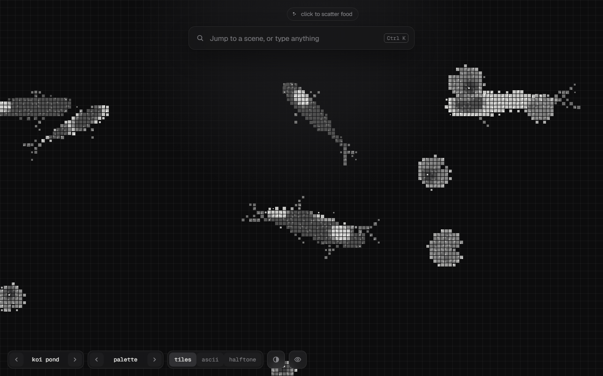

# Procedural scenes

Generative scenes drawn live on a canvas, rendered as tiles, ASCII or halftone. No dependencies besides Vite and TypeScript.

**[Live demo](https://yarooqh.github.io/procedural-scenes/)**

[](https://yarooqh.github.io/procedural-scenes/)

## Scenes

Koi pond, dragon, black hole, planets, deep space, smoke & fire, murmuration and vines. Click in any scene to interact with it: scatter food, toss a pearl, drop a star into the black hole, send a hawk through the flock.

## Interfaces

The scene sits behind a swappable interface: command palette, terminal, chat, waitlist, notebook or player.

## Controls

| Key | |
| --- | --- |
| `←` `→` | Previous / next scene |
| `↑` `↓` | Previous / next interface |
| `1` `2` `3` | Tiles, ASCII, halftone |
| `H` | Hide the interface |
| `Ctrl K` | Jump to a scene (palette interface) |

## Run locally

```bash
npm install
npm run dev
```

`npm run build` type-checks and builds to `dist/`.

## Deployment

Pushes to `main` run [`.github/workflows/pages.yml`](.github/workflows/pages.yml), which builds the app and publishes it to GitHub Pages.

## License

[MIT](LICENSE)
